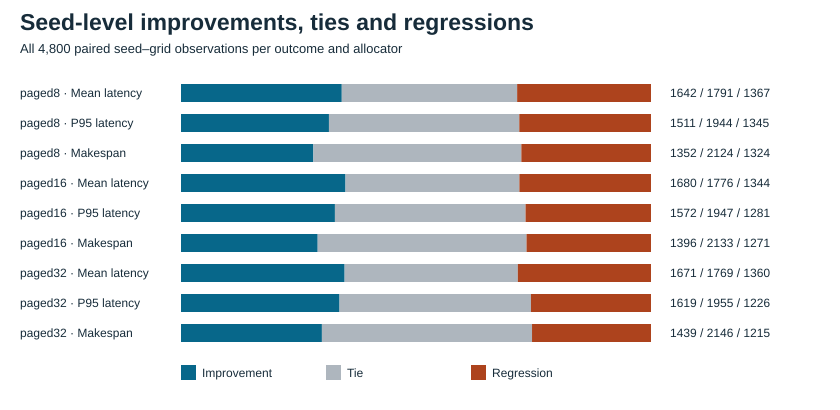
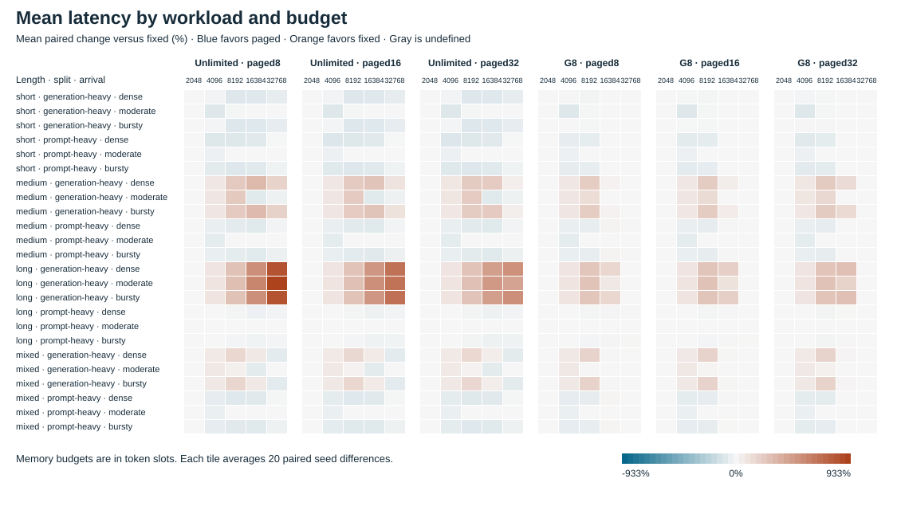
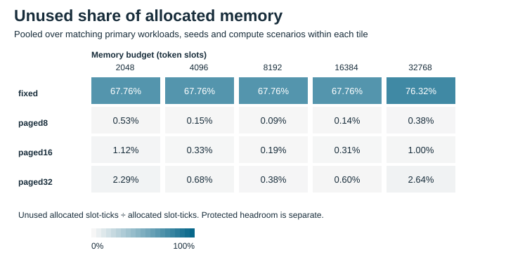
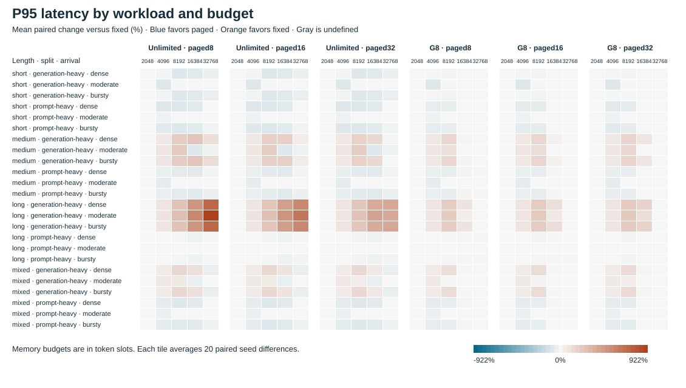
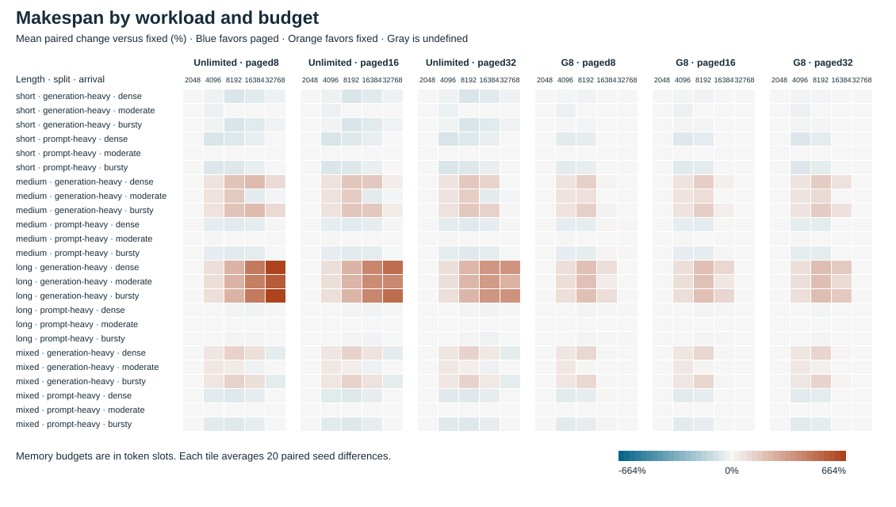
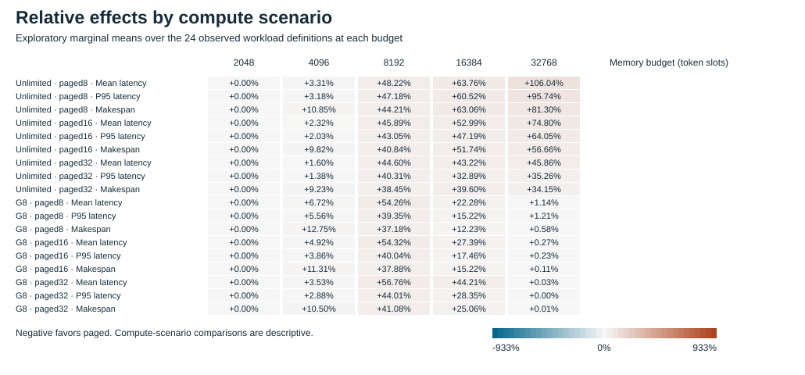

# When Does Paged Allocation Improve Scheduling? A Controlled Simulation Study of KV-Cache Memory

## Abstract

Allocating key–value cache memory in blocks can reduce unused reservation and let more requests enter service. Whether this improves latency depends on how admitted requests share resources during generation. We study this question with a deterministic CPU simulator that combines first-in, first-out admission, oldest-request memory protection, and an optional per-tick generation cap. The frozen design spans 19,200 conditions and 20 matched workload seeds. We compare three paged block sizes with fixed reservation on mean end-to-end latency, nearest-rank p95 latency, and makespan. Across the equally weighted design grid, mean latency increased by 30.57%, 26.29%, and 23.98% for block sizes of 8, 16, and 32 slots, respectively. P95 latency and makespan also increased on average for all three. Individual cells showed improvements, regressions, and ties. All 8,640 paired timing differences at the smallest budget were exactly zero. Paged allocation reduced unused allocated slot-ticks while allowing more requests to reside concurrently. The resulting schedules recorded substantial growth stalls related to protected headroom and more compute deferrals. A separately specified 80-condition exploratory ample-memory control yielded identical request timing across allocators despite large differences in unused allocation. These results show that the timing consequences of memory savings depend on the scheduler and workload in this model. The study evaluates abstract token-slot allocation and does not measure GPU serving performance.

## 1. Introduction

Autoregressive generation extends a request's key–value (KV) cache as output tokens are produced. Reserving space for the maximum sequence at admission makes later growth predictable, but can hold memory that other requests could use. Allocating in blocks as sequences grow can admit more requests into the same budget. Those additional residents still need generation opportunities and room for further growth. A memory-efficient schedule can therefore change both how soon requests enter service and how long they remain there.

We examine this tradeoff with a common scheduler and matched realized workloads. The main outcomes distinguish average request latency, tail latency, and the time needed to drain the entire workload. The design includes both heavily constrained and less constrained budgets, different balances of prompt versus generated tokens, and two compute settings. A separate ample-memory control tests timing agreement when the same scheduler can admit and advance requests without memory interference.

## 2. Related work

Orca introduced iteration-level scheduling so that a serving system could change batch membership across generation iterations, along with selective batching for transformer operations [2]. It motivates studying progress at the level of generation steps. The present simulator assigns abstract token opportunities in admission order and omits the implementation costs and model execution of a serving system. [USENIX proceedings](https://www.usenix.org/conference/osdi22/presentation/yu)

Kwon et al. introduced PagedAttention and implemented it in vLLM [1]. Their attention algorithm operates over noncontiguous KV blocks and supports block sharing. They evaluated throughput and latency in an implemented serving system. Our paged allocator borrows the idea of block-rounded allocation on demand. The experiment varies the allocation rule within a particular FIFO policy and token-slot model. It provides evidence about that policy and abstraction. [SOSP proceedings](https://sigops.org/s/conferences/sosp/2023/toc.html) · [Author manuscript](https://arxiv.org/abs/2309.06180)

## 3. Research questions and hypotheses

**RQ1.** For the same realized workload, memory budget, and compute scenario, how does each paged block size change mean latency, p95 latency, and makespan relative to fixed reservation?

**RQ2.** How do the direction and magnitude of those differences vary across the planned cells and matched seeds?

A motivating expectation was that smaller allocations can reduce admission pressure. The frozen analysis plan also allowed for null effects under sparse arrivals or limited compute, and for worse outcomes when rounding or protection restricts progress. The analysis quantifies all planned contrasts descriptively. The separately specified control predicted exact timing agreement and zero memory blocking and growth stalls when memory was ample. [Frozen analysis plan](../PHASE3_ANALYSIS_PLAN.md) · [Prospective control specification](../phase3/research_batch/3e4b/ample_memory_control/specification.json)

## 4. Simulator and scheduling model

Each workload supplies arrivals, prompt lengths, and realized output lengths. The scheduler sees arrival and prompt length. The execution component holds output length and signals completion after prefill or after successful generation. This prevents the scheduler from using future output length to make admission or growth decisions. Modeled prefill places the prompt in memory at admission, takes no simulated time, and consumes no generation opportunity.

**Allocation and protection.** Let *M* be the common maximum prompt-plus-output length, *B* the memory budget in token slots, and *b* a paged block size. Fixed assigns *M* slots throughout residence. Paged assigns `b × ⌈ℓ / b⌉` slots at resident length ℓ and adds space at block boundaries. The worst-case footprint *R* is *M* for fixed and `b × ⌈M / b⌉` for paged. The oldest active request has protected, currently unallocated headroom `H = R − a_oldest`, where `a_oldest` is its current allocation. With no active request, `H = 0`. At every transition live tokens *U*, allocation *A*, and headroom satisfy `0 ≤ U ≤ A`, `H ≥ 0`, and `A + H ≤ B`. Growth of the oldest trades protected headroom for allocation. When it completes, protection transfers to the next oldest as part of the release.

**Clock and admission.** At integer tick *t*, releases from the preceding generation interval have already occurred. Arrivals through *t* enter a queue ordered by arrival timestamp and then input ID. Admission examines the head repeatedly while its prompt allocation fits and preserves the resulting headroom. A failed head stops admissions for the tick, with no bypass. A prompt-only request, which the simulator supports outside the primary workload generator, releases immediately after admission. Idle time can be skipped by the event loop and still contributes to elapsed simulated time.

**Generation and release.** After admissions, the simulator visits requests still requiring output in admission order, attempting at most one token per request in `[t, t + 1)`. Under G8, the cap is eight successful token generations per tick. Later eligible visits in that tick count as compute deferrals before any memory eligibility check. Earlier unsuccessful memory checks consume no generation opportunity. The memory check tests physical allocation first and protected headroom second, yielding mutually exclusive stall counts. Memory is sampled after all token attempts and before releasing requests that completed on that tick. Their final token and completion occur at `t + 1`. [Frozen scheduler description](../PHASE3_README.md) · [Simulator and allocator implementation](../phase3_simulator.py)

## 5. Experimental design

Table 1 describes the frozen primary factorial grid. The same saved realization for a seed and workload definition was replayed under every budget, allocator, and compute scenario. The generator uses separate deterministic arrival, length, and split streams derived from each seed. The reuse of streams across regime definitions is relevant to the bootstrap in Section 6. The pilot preceded the primary experiment and was excluded from inference.

**Table 1. Frozen primary design.** A workload definition is a length × split × arrival combination. A condition is one realized workload replayed with one budget, allocator, and compute scenario.

| Factor | Levels or count |
|---|---|
| Maximum and workload size | `M = 2,048` tokens per request and 200 requests per workload |
| Seeds | 20 consecutive integers, 20261117–20261136 |
| Length | Short, medium, long, mixed |
| Prompt/generation split | Generation-heavy, prompt-heavy |
| Arrival pattern | Dense, moderate, bursty |
| Memory budget | 2,048, 4,096, 8,192, 16,384, 32,768 token slots |
| Allocation | Fixed reservation, paged8, paged16, paged32 |
| Compute | Unlimited, G8 |
| Workload definitions and realizations | 24 definitions and 480 seeded workloads |
| Conditions | 19,200 primary replays |

[Primary configuration](../phase3/configs/primary.json) · [Generator](../phase3_workloads.py) · [Execution report](../PHASE3_3E3_REAL_PRIMARY_REPORT.md)

## 6. Metrics and statistical analysis

For request *i*, end-to-end latency is `L_i = c_i − a_i`, where `a_i` is arrival and `c_i` is completion, both in simulator ticks. Admission waiting uses admission time in place of completion. A condition's mean latency averages the 200 request latencies as an exact rational number. Its nearest-rank p95 is the 190th ordered latency. Makespan is the final completion tick measured from time zero, including idle time. We compute p95 within each condition before pairing.

For any outcome *Y*, pair paged *P* with fixed *F* on seed, workload definition, realized workload hash, budget, and compute scenario. The seed-level differences are

```text
d_s = Y_P,s − Y_F,s
r_s = 100 × d_s / Y_F,s
```

Negative timing differences favor paged. The sign of the exact tick difference determines a win (negative), tie (zero), or loss (positive). A zero fixed value would leave the relative difference undefined while retaining its absolute difference. There were no undefined denominators or missing pairs. We average the `d_s` and `r_s` equally over seeds for each of the 2,160 planned cells. For each outcome and allocator, the designed-grid statistic averages the 240 cell differences within each seed, then averages those 20 seed means. The relative estimand gives every paired percentage equal weight. Each percentage uses its matched fixed condition as denominator. Requests contribute to condition metrics and seeds are the units of replication.

We drew 10,000 bootstrap samples of 20 seed indices with replacement using Python `random.Random` with analysis seed 20261118. One matrix of draws, indexed to numerically sorted seeds, was shared across comparisons. Each sampled seed carries its complete matched grid, retaining the dependence among settings and reused workload streams. Each designed-grid bootstrap replicate averages the 20 selected seed means, including repeated selections. The pointwise 95% endpoints use linear interpolation at zero-based ranks `(n − 1) × 0.025` and `(n − 1) × 0.975` in the sorted bootstrap estimates. These are descriptive intervals for workload-seed variation under the design. There is no family-wise adjustment and we make no confirmatory significance claims. [Analysis conventions](../phase3/analysis/3e5/IMPLEMENTATION_SPEC.md) · [Bootstrap metadata](../phase3/analysis/3e5/metadata.json)

## 7. Primary results

Mean latency, p95 latency, and makespan increased for all three paged allocators in the designed-grid summaries in Table 2. Relative mean-latency increases ranged from 23.98% to 30.57%. Figure 1 shows how much variation in the direction of the paired differences this average conceals. A timing increase can be larger in magnitude than a timing reduction, so the balance of wins and losses alone does not determine the mean. The complete cell table reports intervals and distributions for the 2,160 cells. The companion [seed-pair table](../phase3/analysis/3e5/seed_pairs.csv) contains all 43,200 individual differences. [Designed-grid summary](../phase3/analysis/3e5/designed_grid_summary.csv) · [Complete cell estimates](../phase3/analysis/3e5/primary_contrasts.csv)

**Table 2. Designed-grid effects of paged allocation versus fixed.** Each estimate equally weights 240 cells and 20 matched seeds. Tick estimates are shown at the precision exported by the analysis. Brackets give pointwise 95% seed-bootstrap intervals. W/T/L counts enumerate the 4,800 seed–cell observations in each row.

| Allocator | Outcome | Mean change in ticks [95% interval] | Mean change in % [95% interval] | W / T / L |
|---|---|---:|---:|---:|
| paged8 | Mean latency | +8441.82804687 [8308.00653052, 8578.970095] | +30.57% [29.65%, 31.53%] | 1,642 / 1,791 / 1,367 |
| paged8 | P95 latency | +14573.4245833 [14370.7155052, 14780.8953802] | +26.80% [25.99%, 27.63%] | 1,511 / 1,944 / 1,345 |
| paged8 | Makespan | +14479.9189583 [14275.2135677, 14689.7458073] | +26.22% [25.53%, 26.94%] | 1,352 / 2,124 / 1,324 |
| paged16 | Mean latency | +8169.47905417 [8029.08680193, 8312.28428714] | +26.29% [25.33%, 27.27%] | 1,680 / 1,776 / 1,344 |
| paged16 | P95 latency | +13904.0252083 [13696.2784323, 14117.0568542] | +21.79% [20.96%, 22.65%] | 1,572 / 1,947 / 1,281 |
| paged16 | Makespan | +13804.6377083 [13593.9397344, 14018.9210833] | +22.36% [21.64%, 23.10%] | 1,396 / 2,133 / 1,271 |
| paged32 | Mean latency | +8061.27055521 [7921.36080036, 8200.76121633] | +23.98% [22.99%, 24.99%] | 1,671 / 1,769 / 1,360 |
| paged32 | P95 latency | +13460.034375 [13260.0239844, 13662.2683646] | +18.51% [17.68%, 19.35%] | 1,619 / 1,955 / 1,226 |
| paged32 | Makespan | +13350.71 [13147.5882083, 13554.5354323] | +19.81% [19.09%, 20.53%] | 1,439 / 2,146 / 1,215 |



**Figure 1. Direction of paired timing differences.** Bars count exact improvements (negative ticks), ties (zero), and regressions (positive ticks) among 4,800 seed–cell comparisons per outcome and allocator. Each observed seed–cell pair contributes one count. Counts do not encode effect magnitude.

Mean cell-level tick differences were negative, zero, and positive in 242, 258, and 220 of the 720 mean-latency cells, respectively. The corresponding counts were 247, 261, and 212 for p95 latency and 234, 280, and 206 for makespan. All 8,640 seed–outcome comparisons at 2,048 slots tied exactly. At this budget, fixed requires the full capacity per request. Under paging the oldest request's allocation plus its protection accounts for the full budget. Both rules therefore allow only one active request at a time. Figure 2 shows how mean-latency changes vary above this budget. Figures A1 and A2 give the corresponding p95 and makespan comparisons. [Complete cell estimates](../phase3/analysis/3e5/primary_contrasts.csv)



**Figure 2. Mean latency by workload and budget.** Each tile shows the mean of 20 paired percentage changes in condition-level mean latency versus fixed. Rows are workload definitions, columns within each panel are budgets in token slots, and panels distinguish compute scenario and allocator. Blue marks reductions and orange marks increases. The scale is specific to this outcome.

Two planned cells illustrate opposite outcomes at 8,192 slots. For dense, long, generation-heavy workloads with unlimited compute, paged8 increased mean latency by 270.72% [270.28%, 271.14%] and makespan by 249.75% [248.78%, 250.79%]. Both outcomes regressed in all 20 seeds. For dense, long, prompt-heavy workloads under G8, paged32 reduced mean latency by 14.75% [13.48%, 15.95% reduction] and p95 latency by 14.67% [13.88%, 15.49% reduction]. Both outcomes improved in all 20 seeds. These examples differ in split, compute setting, and block size. Their comparison cannot isolate the effect of any one factor. [Complete cell estimates](../phase3/analysis/3e5/primary_contrasts.csv)

## 8. Mechanism diagnostics and exploratory interactions

**Variation by design factor.** Equal-weight marginal mean-latency changes across the three paged comparisons were −27.73% for short, +28.99% for medium, +102.66% for long, and +3.87% for mixed workloads. Generation-heavy workloads averaged +76.36%, and prompt-heavy workloads −22.46%. Dense, moderate, and bursty arrivals averaged +27.22%, +26.36%, and +27.27%. Across ascending budgets, the marginal changes were 0.00%, +3.74%, +50.67%, +42.31%, and +38.02%. These summaries average across the other design factors and can conceal changes in direction. [Complete cell estimates](../phase3/analysis/3e5/primary_contrasts.csv)

Under unlimited compute, the mean-latency changes for paged8, paged16, and paged32 averaged +44.27%, +35.20%, and +27.06%. Under G8 they averaged +16.88%, +17.38%, and +20.91%, reversing the ordering of the block sizes. These averages weight the five budgets and 24 workload definitions equally within each setting. Figure A3 disaggregates by budget and shows all three timing outcomes. Direct comparisons across budgets, compute settings, and block sizes are exploratory marginal comparisons. [Compute variation](../phase3/analysis/3e5/compute_variation.svg)

**Allocation and concurrency.** Figure 3 shows the ratio of summed unused physical allocation to summed physical allocation. Averaged over the design, unused allocated slot-ticks per condition were 106.33 million for fixed and ranged from 0.51 million for paged8 to 2.22 million for paged32. Fixed unused allocation includes slack in the maximum-length reservation. Paged unused allocation measures internal block-rounding slack. Protected headroom is unallocated capacity and is counted separately. The condition-level peak active counts averaged 5.71 requests for fixed and ranged from 43.02 to 45.20 across paged allocators. Each condition contributes its maximum observed active count with equal weight. Peak residency can include requests that are stalled or deferred. [Diagnostic cell means](../phase3/analysis/3e5/diagnostics.csv)



**Figure 3. Pooled unused share of allocated memory.** Each allocator–budget tile divides summed unused allocated slot-ticks by summed allocated slot-ticks over all primary workloads, seeds, and compute settings at that budget. This ratio weights conditions by their allocation volume over time. It excludes protected headroom.

**Waiting and progress.** Fixed averaged 26,109 physical admission-blocked ticks per condition. Paged averaged 560 to 575, alongside 29,454 to 30,566 protection-related admission-blocked ticks. Admission blocking counts a failed queue-head attempt once per tick. A physical failure occurs when adding the candidate allocation would exceed capacity before accounting for headroom. A protection failure occurs when the total allocation fits but adding protected headroom would exceed capacity. Protected-headroom growth stalls count eligible request-ticks and averaged approximately 1.36 to 1.52 million per paged condition, compared with zero for fixed. Compute deferrals averaged 113,457 to 129,268 per paged condition and 6,168 for fixed across the two compute settings, with no compute deferrals under unlimited compute. Table A1 reports these diagnostics by allocator. [Diagnostic cell means](../phase3/analysis/3e5/diagnostics.csv)

The mean admission wait was 12,121 ticks for fixed and ranged from 12,366 to 12,845 ticks for paged. Admitting a request earlier in a particular condition can still leave it waiting for token opportunities after admission. Mean progressing requests equals total generated tokens divided by makespan. Generated tokens are identical within each matched allocator pair. A shorter makespan necessarily raises this measure within the pair. The equally weighted mean of its paired percentages was +9.96%, +12.23%, and +13.73% for paged8, paged16, and paged32. Both this mean and the grid mean of makespan percentages can increase because averaging reciprocals differs from taking the reciprocal of an average. [Secondary progressing estimates](../phase3/analysis/3e5/secondary_progressing.csv)

## 9. Exploratory ample-memory negative control

After the primary design was frozen, a separate exploratory control was specified before its execution. The first canonical definition, short, generation-heavy, and dense, supplied 20 saved workload realizations. Each was replayed with all four allocators with unlimited compute and a budget of 409,600 slots. This equals 200 maximum-length reservations and is sufficient for every request to reside simultaneously at its maximum footprint. The control predicted zero admission blocking, zero growth stalls, and exact timing agreement.

All 80 saved conditions met these predictions. Within each seed, admission, first-token, completion, waiting, and end-to-end latency values agreed exactly across allocators. Aggregate waiting, latency, and makespan also agreed. As shown in Table 3, the allocators used the same number of slot-ticks and held substantially different amounts of unused allocation. The historical planning count of 640 controls lacked a complete scientific specification and was never executed. The 80-condition control is separate from the originally frozen primary contrasts and covers one workload definition under ample memory and unlimited compute. [Prospective specification](../phase3/research_batch/3e4b/ample_memory_control/specification.json) · [Readiness review](../PHASE3_3E4A_CONTROLS_ANALYSIS_READINESS.md) · [Control execution report](../PHASE3_3E4B_AMPLE_MEMORY_CONTROL_REPORT.md) · [Exploratory control analysis](../phase3/analysis/3e5/EXPLORATORY_CONTROL.md)

**Table 3. Exploratory control allocation totals.** Each row sums 20 matched realizations. The final column divides unused allocated slot-ticks by allocated slot-ticks.

| Allocator | Allocated slot-ticks | Used slot-ticks | Unused allocated slot-ticks | Pooled unused share |
|---|---:|---:|---:|---:|
| fixed | 718,852,096 | 40,340,732 | 678,511,364 | 94.3882% |
| paged8 | 41,568,896 | 40,340,732 | 1,228,164 | 2.9545% |
| paged16 | 42,971,104 | 40,340,732 | 2,630,372 | 6.1213% |
| paged32 | 45,777,280 | 40,340,732 | 5,436,548 | 11.8761% |

## 10. Discussion

Within this simulator, reducing unused allocation can change when requests enter service and how many requests compete during generation. The protection rule guarantees the oldest active request room to grow. Younger requests can remain resident and encounter physical or headroom constraints. Under G8 they may also be deferred when earlier successful attempts exhaust the generation cap. These model rules make it possible for expanded residence to coexist with more waiting, longer latency, or later workload completion. The measured concurrency, stalls, and deferrals are consistent with that explanation. Their relative contributions would require separate controlled ablations.

The 2,048-slot and ample-memory cases show two distinct routes to identical timing. At the tightest primary budget, protection limits both kinds of allocation to one resident at a time. In the ample-memory control, enough capacity is available to avoid blocking altogether, and unlimited compute lets every active request advance each tick. At intermediate and higher primary budgets, the allocation rules can change residency and token eligibility in different ways across workloads. The full grid contains both favorable and adverse cells, and its relative averages summarize their magnitude with weights chosen by design.

## 11. Threats to validity and limitations

The simulator is deterministic CPU code with fungible token slots and a logical event clock. It abstracts away allocator overhead, prefill compute, memory bandwidth, block sharing, swapping, external fragmentation, and GPU kernels. G8 caps successful tokens per tick independent of sequence length and physical batch cost. The findings provide no empirical estimate of GPU speed, measured vLLM throughput, or deployment latency.

The FIFO no-bypass rule and oldest-request protection are modeling choices. Effects can differ with another priority policy, preemption, or another memory model. The generated workload distributions and 20 seeds define the variation sampled here. Reused streams create dependence within a seed across workload definitions and settings, which the shared cluster resampling preserves. Grid estimates depend on equal design weights and could differ under another workload mix. Pointwise intervals neither control error across the 2,160 cells nor characterize hardware variability. The diagnostic associations do not identify causal contributions of individual scheduling mechanisms. The exploratory control is limited to one canonical definition and one compute setting.

The primary execution recorded command elapsed time of 13 h 7 min 51 s, workflow monotonic elapsed time of 6 h 34 min 32 s, and summed condition timers of 6 h 30 min 10 s. The discrepancy remains unresolved. Host elapsed time is distinct from the simulator ticks used in every scientific timing estimate. [Primary execution report](../PHASE3_3E3_REAL_PRIMARY_REPORT.md) · [Statistical results report](../PHASE3_3E5_PRIMARY_STATISTICAL_RESULTS.md)

## 12. Reproducibility and artifact availability

The study artifacts are in the `paged_attention` repository on branch `phase-3-memory-aware-scheduling`, with scientific HEAD `df794b67e72740bffb6272248b9d609c8decfaea`. The manifests bind the ordered inventories and pinned source identities, and saved conditions carry row checksums. Appendix B lists SHA-256 identities. The analysis consumes 19,200 primary and 80 separate control records. The 384 pilot records were preserved outside inference. The paths below describe repository-local availability. At the scientific HEAD, the research-batch runner, its protocol, saved condition records, and analysis pipeline are outside the tracked tree. Reproduction requires the pinned source and data distribution described in the release plan. [Artifact release plan](ARTIFACT_RELEASE_PLAN.md)

Run the analysis from the repository root against the saved records using Python 3.12.3 and NumPy 1.26.4, as recorded in the analysis metadata. The command writes regenerated outputs to a temporary directory and does not dispatch new simulation conditions.

```sh
OPENBLAS_NUM_THREADS=1 VECLIB_MAXIMUM_THREADS=1 python3 phase3_primary_analysis.py --output "$(mktemp -d)"
```

The analysis milestone validated the full condition inventory, checked 43,200 unique pair keys and independently reconstructed selected estimates and intervals from saved request records. Two runs produced byte-identical generated outputs, including the shared resampling matrix. Six analysis tests and 67 existing validation tests passed during that milestone. Readers can find the complete contrasts, exact seed pairs, designed-grid summaries, diagnostics, exploratory control outputs, shared seed indices, and all six figures under `phase3/analysis/3e5/`. [Figure and table index](FIGURE_TABLE_INDEX.md) · [Analysis script](../phase3_primary_analysis.py) · [Primary manifest](../phase3/research_batch/3e3/primary/manifest.json) · [Control manifest](../phase3/research_batch/3e4b/ample_memory_control/manifest.json) · [Repeatability and integrity checks](../PHASE3_3E5_PRIMARY_STATISTICAL_RESULTS.md)

## 13. Conclusion

Under memory-aware FIFO scheduling with oldest-request protection, paged allocation substantially reduced unused physical allocation. All three paged block sizes nevertheless increased mean latency, p95 latency, and makespan on average over the frozen grid. Favorable cells and exact ties show that timing depended on the workload, memory budget, and generation rules. The ample-memory control further shows that different allocation overhead can coexist with identical request timing. In this token-slot model, memory utilization and scheduling outcomes require separate measurement.

## 14. References

1. Woosuk Kwon, Zhuohan Li, Siyuan Zhuang, Ying Sheng, Lianmin Zheng, Cody Hao Yu, Joseph E. Gonzalez, Hao Zhang, and Ion Stoica. 2023. Efficient Memory Management for Large Language Model Serving with PagedAttention. *Proceedings of the 29th Symposium on Operating Systems Principles*, 611–626. [DOI 10.1145/3600006.3613165](https://doi.org/10.1145/3600006.3613165) · [arXiv:2309.06180](https://arxiv.org/abs/2309.06180)
2. Gyeong-In Yu, Joo Seong Jeong, Geon-Woo Kim, Soojeong Kim, and Byung-Gon Chun. 2022. Orca: A Distributed Serving System for Transformer-Based Generative Models. *16th USENIX Symposium on Operating Systems Design and Implementation*, 521–538. [USENIX proceedings](https://www.usenix.org/conference/osdi22/presentation/yu)

## Appendix A. Supplementary results

Figures A1 and A2 complement Figure 2 with p95 latency and makespan over the same full set of budgets, workload definitions, compute scenarios, and comparators. Figure A3 shows the corresponding exploratory compute summaries. Each outcome heatmap uses its own color range.



**Figure A1. P95 latency by workload and budget.** Each tile averages 20 paired percentage differences in condition-level nearest-rank p95 versus fixed. Columns give budgets in token slots. Rows give workload definitions. Panels distinguish allocator and compute scenario. Blue favors paged and orange favors fixed.



**Figure A2. Makespan by workload and budget.** Each tile averages 20 paired percentage differences in simulated makespan versus fixed. Rows, columns, and panels use the same design dimensions as Figure A1. Blue favors paged and orange favors fixed.



**Figure A3. Exploratory compute-scenario variation.** Each tile is the mean paired percentage change versus fixed at the indicated budget, compute scenario, allocator, and outcome, averaging the 24 workload definitions and 20 seeds equally. Budgets are in token slots. Negative timing changes favor paged. The figure displays separate marginal means for G8 and unlimited rather than a subtraction between them.

Table A1 gives the diagnostic means discussed in Section 8. Each allocator row averages the 240 design cells and 20 seeds equally. The full diagnostic table also includes p95 waiting, physical growth stalls, allocated and used slot-ticks, protected headroom slot-ticks, and peak occupancy ratios. Peak allocated occupancy divides peak allocated slots by budget. Peak live occupancy divides peak used slots by budget. [Complete diagnostic table](../phase3/analysis/3e5/diagnostics.csv)

**Table A1. Exploratory scheduling and memory diagnostics.** Wait and admission blocking are in ticks. Growth stalls and deferrals are in request-ticks. Peak concurrency counts active requests. Unused allocation is in slot-ticks.

| Allocator | Mean wait | Peak concurrency | Physical admission blocking | Protection admission blocking | Protected growth stalls | Compute deferrals | Unused allocation |
|---|---:|---:|---:|---:|---:|---:|---:|
| fixed | 12,121 | 5.71 | 26,109 | 0 | 0 | 6,168 | 106,334,661 |
| paged8 | 12,366 | 45.20 | 560 | 29,454 | 1,516,242 | 129,268 | 508,424 |
| paged16 | 12,497 | 44.54 | 564 | 29,718 | 1,441,197 | 123,476 | 1,080,449 |
| paged32 | 12,845 | 43.02 | 575 | 30,566 | 1,359,680 | 113,457 | 2,222,891 |

The exact rational mean tick differences underlying Table 2 are shown in Table A2. Bootstrap endpoints in Table 2 use the saved numerical precision. [Exact seed pairs](../phase3/analysis/3e5/seed_pairs.csv)

**Table A2. Exact designed-grid mean differences in simulator ticks.** Values average 4,800 exact paired differences per allocator and outcome.

| Allocator | Mean latency | P95 latency | Makespan |
|---|---:|---:|---:|
| paged8 | 108055399/12800 | 34976219/2400 | 69503611/4800 |
| paged16 | 1960674973/240000 | 66739321/4800 | 66262261/4800 |
| paged32 | 7738819733/960000 | 4307211/320 | 1335071/100 |

## Appendix B. Workload and protocol details

**Length and split.** Short, medium, and long total sequence lengths are sampled uniformly from the inclusive integer ranges 32–256, 257–1,024, and 1,025–2,048, respectively. Mixed workloads independently choose those regimes with probabilities 60%, 30%, and 10% for each request, then sample the corresponding range. For total length *L*, one component is uniform over the inclusive range from 1 to `min(128, L − 1)`, and the other component is the remainder. Generation-heavy workloads sample the prompt component. Prompt-heavy workloads sample the output component.

**Arrivals and stream pairing.** The first arrival is at tick zero. Subsequent dense and moderate gaps are uniform integers from 0 to 8 and 0 to 64, respectively. Bursty request *i*, with zero-based index, arrives at tick `128 × floor(i / 32)`. The generator derives separate pseudorandom length, split, and arrival streams from the seed and stream name. The saved workload hash binds the realized request list and generator metadata. It must match within every allocator pairing. [Generator specification](../PHASE3_README.md) · [Generator implementation](../phase3_workloads.py)

**Accounting.** At each busy tick, the active requests still requiring output are classified exactly once as successful, physically growth-stalled, protection growth-stalled, or compute-deferred. Admission blocking uses separate counters. Unused allocation is accumulated allocated slot-ticks minus used slot-ticks. Protected headroom is tracked separately. [Simulator](../phase3_simulator.py) · [Research-batch protocol](../PHASE3_RESEARCH_BATCH_PROTOCOL.md)

Table B1 identifies the frozen inputs and shared resamples that support replication.

**Table B1. SHA-256 identities.** Manifest file digests identify whole files. Embedded manifest identity digests cover the canonical manifests with their identity fields omitted.

| Artifact | SHA-256 |
|---|---|
| Primary configuration | `3753af5cb496b4ba395a8f846b4871c0060407de75828e00d445206bad46d8fa` |
| Frozen paired analysis plan | `eff60269f9fa72efa552be796f432cce46ee231def9b3676999d2d565f860c93` |
| Primary manifest file | `17983e334c0980cbaabafa9da4fe2e9935977848475043de92db4906105a8b48` |
| Primary manifest identity | `bd289f8d52cc58bf8c0a14e57fb9231c394e092e3de78d4583df69eb7620c84d` |
| Exploratory control manifest file | `6ca36528c01b1af6c6d95814d850ce68a2b034e5d4de3976b97c9e5049ee99fe` |
| Exploratory control manifest identity | `6198d22c9d16d52f994a85e908fb42a36466fdeab186e300d06ceb5190dcb8fd` |
| Analysis implementation specification | `048fec70fa9701fd112c44d45e3c78e56de8a7f3574d304780fca5b2d35b27d8` |
| Analysis implementation | `708af9d99730a66cef6955099ee3e4e37243be75e4245172b968421e322928a9` |
| Shared seed-index CSV | `b99485a155a35e9f47a55916fe50a7bc752ca72d68e1d77386cdafa4d5f2f7de` |

[Analysis metadata](../phase3/analysis/3e5/metadata.json) · [Frozen analysis plan](../PHASE3_ANALYSIS_PLAN.md) · [Primary configuration](../phase3/configs/primary.json)
